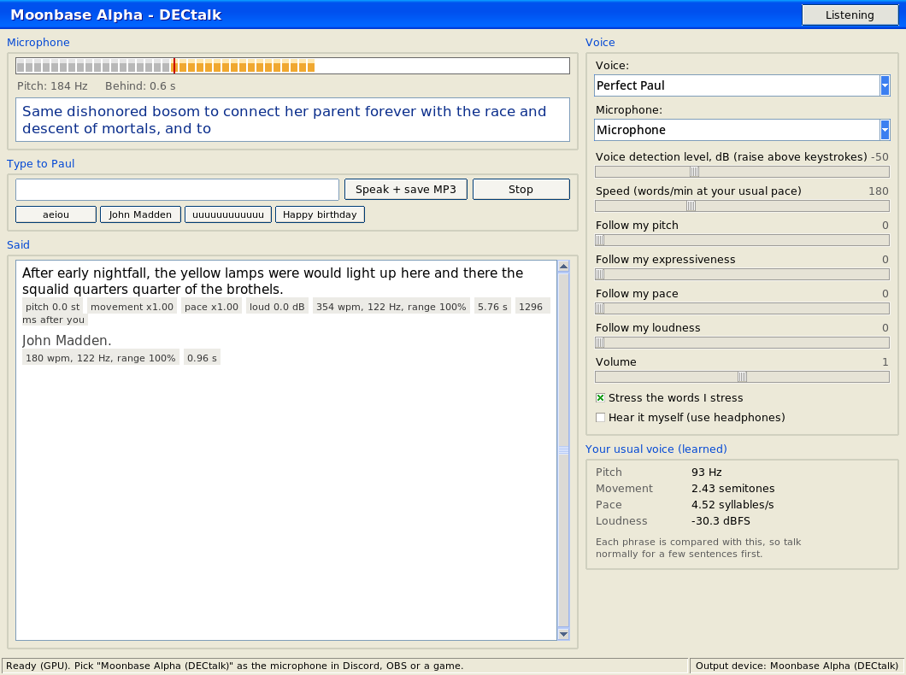

# Moonbase

Talk into your mic and DECtalk (Perfect Paul, the Moonbase Alpha voice) says it out of a virtual
microphone called **Moonbase Alpha (DECtalk)**. Pick that device in Discord, OBS, a game, etc.



Each word is spoken as soon as you've said it. By default Paul keeps his own flat delivery, like in the game,
except for stressed words and questions. Raise the "Follow my ..." sliders (0 by default) and he follows how
you said it: your voice is compared with your usual one (learned as you talk) and DECtalk is told to match:

| You | DECtalk |
|-----|---------|
| higher / lower pitch on this word | average pitch `[:dv ap]` |
| animated / monotone | pitch range `[:dv pr]` |
| faster / slower | `[:rate]`, and each word is fitted into the time you took |
| louder / quieter | gain on the samples |
| a word you stress (pitch peak + loudness) | emphatic stress `["]` |
| rising ending | question intonation `?` |

## Setup (Linux)

Linux with PipeWire (`pactl`, `pw-record`), the system Python with Tk (`pacman -S tk`), `uv`, `curl`, `git`,
and a C toolchain (`gcc`, `make`, `autoconf`, `automake`) to build DECtalk.

```
./setup.sh   # once: builds DECtalk -> vendor/, Parakeet speech model (~1.1 GB) -> models/, deps -> .venv/,
             # and adds "Moonbase Alpha" to the app launcher
```

Then open **Moonbase Alpha** from the app launcher. Closing the window stops it and removes the virtual mic.
Only one copy runs at a time. Everything lives in this folder; `settings.json` holds the window's settings.
To remove the launcher entry: `rm ~/.local/share/applications/moonbase.desktop`.

## Windows

The Windows version is built by `.github/workflows/windows.yml` on a GitHub Windows runner (run it from the
Actions tab, or push a `v*` tag). It builds DECtalk with Visual Studio from the same pinned commit, packages
the app with PyInstaller, runs `Moonbase.exe --selftest` (DECtalk, recognition, MP3; the runner has no audio
devices), and publishes a release with two zips:

- `Moonbase-windows.zip`: the app, DECtalk and the speech model. Recognition runs on the CPU.
- `Moonbase-windows-GPU-pack.zip`: NVIDIA's CUDA/cuDNN DLLs and ONNX Runtime's CUDA plugin. Unzipped on top
  of the first, recognition runs on an NVIDIA GPU. Separate because a release file can be at most 2 GiB.

Windows can't create a microphone by itself, so DECtalk is played into VB-Audio Virtual Cable, and other
programs use "CABLE Output" as the microphone. VB-Audio's package ships unmodified in `vbcable\` (their
licence allows it, with the donationware notice the app and guide show). On the first start without it,
Moonbase offers to run VB-Audio's installer, then rescans the audio devices and switches to the cable.
`packaging/windows/README.txt` is the user guide that ships in the zip. Everything fetched is pinned by hash.

## How it works

- `app.py`: the window (Tk, Windows XP styled), launched by the `.desktop` entry or `Moonbase.exe`.
- `audio_linux.py` / `audio_windows.py`: mic in and DECtalk out (PipeWire virtual mic / WASAPI and the
  virtual cable).
- `moonbase.py`: mic (`pw-record`, unbuffered: 20 ms blocks) -> NVIDIA Parakeet TDT 0.6B v2 on the GPU
  (sherpa-onnx CUDA build), which re-transcribes the current utterance every 50 ms (one pass: ~10-30 ms).
  A word is spoken once three passes in a row agree on it and a later word exists (or you've been quiet
  for a moment); words agreed on together go to DECtalk as one clause, and DECtalk speeds up to 2× your
  speed setting to keep up. Output: a `module-pipe-source` PipeWire source, written in real time. At a
  pause (0.3 s) the rest is spoken, the last word with the sentence ending, and the utterance, with the
  model's word times, is used to learn your usual voice.
- `prosody.py`: per-10 ms loudness and pitch (YIN), measurement against your baseline, the DECtalk text
  with in-line commands, and per-word gain.
- `dectalk.py`: the DECtalk engine in-process through ctypes (speech-to-memory, index marks).
  The engine is [dectalk/dectalk](https://github.com/dectalk/dectalk), built from source at a pinned commit
  by `setup.sh`. No prebuilt engine binaries are downloaded.

Measured on recorded speech (two LibriSpeech clips, 66 words, so roughly): you hear a word about 1.2 s after
you start saying it; 4-6 of the 66 words wrong. Now and then the model invents a few words at the end of
what it has heard so far ("which is the only thing that"), and they get spoken.

Needs an NVIDIA GPU with the CUDA 13 runtime installed system-wide (`pacman -S cuda`). cuDNN and cuBLAS come
from NVIDIA's Python packages inside `.venv/`; the sherpa-onnx CUDA wheel is the maintainer's build from
Hugging Face (`csukuangfj2/sherpa-onnx-wheels`), pinned by URL and hash in `uv.lock`.

## Tips

- Keystrokes or other noise counting as speech: raise "Voice detection level" (or click/drag on the mic
  meter) until the red line sits above the noise but below your voice. Grey blocks are ignored, green ones
  count as speech.
- "Hear it myself" loops the virtual mic to your default output. Use headphones, or the mic hears Paul.
- The typing box takes raw DECtalk input, so Moonbase Alpha songs work (`[:phoneme on]` is already set).
- "Speak + save MP3" says the typed text and saves it as an MP3 (44.1 kHz, full volume whatever the Volume
  slider says) to share; it asks where, starting in Downloads.
